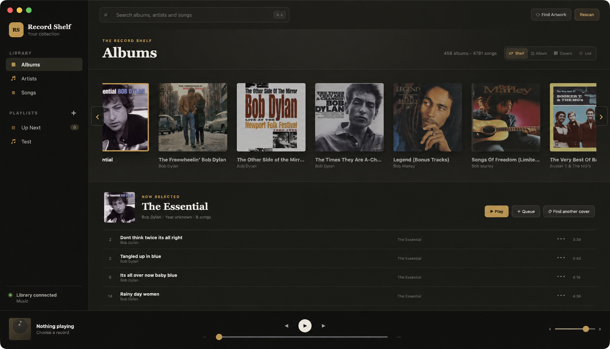

# Record Shelf

Record Shelf is an album-first music player for macOS, Windows and Android libraries stored locally or on a NAS. It builds a fast local catalogue, retains cover artwork locally, and plays the original files directly from their source.



## macOS development

1. Mount the NAS share in Finder (`Go` → `Connect to Server…`, usually `smb://your-nas/music`).
2. Install dependencies with `npm install`.
3. Run `npm run dev`.
4. Choose the mounted music folder in Record Shelf.

The first scan reads tags and artwork sequentially to avoid overwhelming a NAS. Subsequent scans reuse unchanged records instead of rereading every file over the network. If the share is unavailable, the existing catalogue is retained rather than cleared. Supported formats include MP3, M4A/AAC/ALAC, FLAC, Ogg/Opus, WAV, AIFF and WMA where Chromium has a matching decoder.

## Test the Android app

The Android preview supports phones and tablets with touch-sized controls, responsive album layouts, playlists and the visible **•••** action button for Play Next, Add to Queue and Add to Playlist. It scans through Android's system folder picker, stores its catalogue in private app storage, retains the folder permission across restarts, and caches embedded album art inside the app.

To get an APK without installing Android Studio:

1. Open the repository's **Actions** tab on GitHub.
2. Select **Android APK**, then choose the latest successful run. You can also use **Run workflow** to start a build manually.
3. Download the `record-shelf-android-debug` artifact and unzip it.
4. Move `Record-Shelf-Android-debug.apk` to the Android device, allow installs from that source when prompted, and open the APK.

For music on a NAS, first configure an Android file manager or Documents Provider that exposes the SMB share in Android's system **Files** picker. In Record Shelf, tap **Choose Music Folder** and select that exposed folder. Provider performance and supported audio codecs vary by device; no music is copied into Record Shelf.

This is an unsigned-for-production debug APK intended for sideloaded testing, not a Play Store release. GitHub Actions retains each ordinary build artifact for 30 days. Tagged builds are also attached to a persistent GitHub prerelease: create and push a tag such as `v0.3.0` when a test build is ready to keep.

### Local Android development

Install Android Studio with SDK 36 and JDK 21, then run:

```bash
npm ci
npm run android:open
```

To build a debug APK directly, run `npm run android:apk`. The output is `android/app/build/outputs/apk/debug/app-debug.apk`.

## Album views and artwork

- **Shelf** presents a horizontally scrollable, trackpad-friendly row of records with the selected album's tracks below.
- **Album** keeps a large cover at the upper left with metadata and tracks on the right.
- **Covers** displays a traditional artwork grid.
- **List** displays compact album rows that expand to reveal their tracks.

Record Shelf uses embedded artwork first, then common folder images such as `cover.jpg` and `folder.jpg`. Use **Find Artwork** to retrieve missing covers from MusicBrainz and the Cover Art Archive. Individual albums can also be refreshed. Online artwork requests send the album and artist names to MusicBrainz and are limited to one search per second.

The Artists view displays cached artist portraits when available and falls back to a representative album cover. **Find Artist Photos** matches artists through MusicBrainz, retrieves freely reusable images from Wikipedia or Wikimedia Commons, and keeps the downloaded portraits in Record Shelf's local artwork cache across restarts. Android currently uses the album-cover fallback for artist cards.

## Build installers

- macOS: `npm run package:mac`
- Windows: `npm run package:win`
- Android debug APK: `npm run android:apk`

Windows can use a mapped drive or UNC share. The shared Electron/TypeScript application needs no architectural rewrite for Windows; platform-specific packaging and media-key QA remain separate release work.

## Keyboard controls

- Space: play/pause
- Command/Ctrl + Right: next track
- Command/Ctrl + Left: previous track
- Command/Ctrl + .: stop
- Command/Ctrl + O: choose music folder
- Command/Ctrl + L: focus search

Hardware play/pause, previous and next media keys are registered while the app is running.
